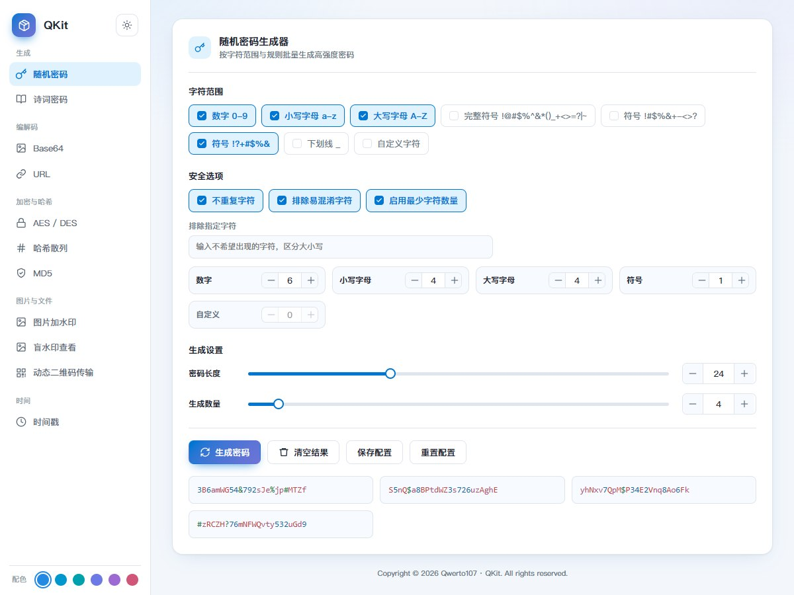
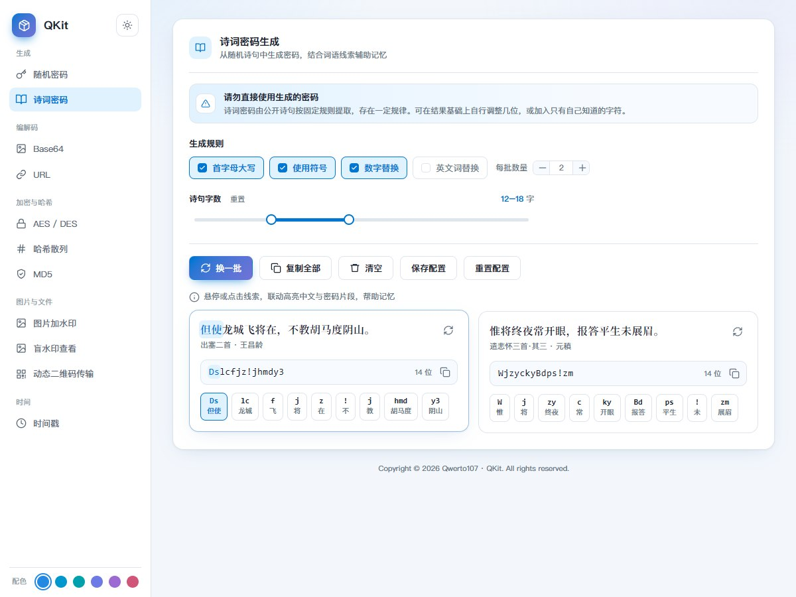
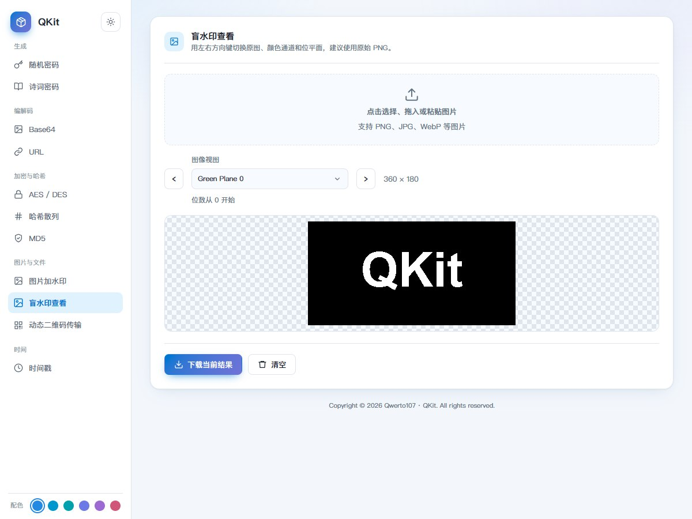

<div align="center">


# QKit

可自托管的纯前端工具箱。在浏览器里生成密码、处理图片、传输文件和转换数据。

[快速部署](#快速部署) · [文档中心](docs/README.md) · [使用指南](docs/usage.md) · [下载版本](https://github.com/Qwerto107/QKit/releases)

**Vite + JavaScript** · **浏览器本地处理** · **静态站点 / Docker**

无需账号或数据库。文本和文件在浏览器中处理。

</div>

---

## 界面一览

每个工具都有独立地址，支持深浅主题和六种配色。



<details>
<summary><strong>查看更多：诗词密码和盲水印查看</strong></summary>





截图使用演示内容。

</details>

## 功能

| 工具 | 路由 | 使用方式 |
| --- | --- | --- |
| 随机密码 | `/password` | 批量生成，设置字符范围、指定排除字符、最少数量及去重 |
| 诗词密码 | `/poetry` | 按诗句字数随机抽样，在原句和密码中联动高亮，支持英文词替换 |
| Base64 | `/base64` | 文本编解码与图片 Data URI 转换 |
| URL | `/url` | URL 组件和完整 URL 的编解码、查询参数解析 |
| AES / DES | `/crypto` | 对称加解密，支持多种模式与输出格式 |
| 哈希散列 / MD5 | `/hash`、`/md5` | 摘要、HMAC、文本及文件 MD5 |
| 图片加水印 | `/watermark` | 批量添加文字水印，单张下载 PNG，多张可打包 ZIP |
| 盲水印查看 | `/blind-watermark` | 查看颜色通道和低三位的位平面，可下载处理结果 |
| 动态二维码传输 | `/animated-qr` | 将小文件分帧播放，可用摄像头接收或导入二维码图片 |
| 丑丑头像生成 | `/ugly-avatar` | 在本地随机生成手绘头像，下载 PNG |
| 简单头像生成 | `/simple-avatar` | 在本地随机生成极简头像，下载 PNG 或 SVG |
| 时间戳 | `/timestamp` | 日期、时间戳与固定时区偏移互转 |
| JSON 格式化 | `/json` | 格式化、压缩和校验 JSON |
| JWT 解码 | `/jwt` | 查看 Header、Payload 和过期时间；不验证签名 |
| UUID / ULID | `/uuid-ulid` | 批量生成 UUID v4 或 ULID |
| 二维码 | `/qrcode` | 生成文本二维码，下载 PNG 或识别本地图片 |
| 文本 Diff | `/diff` | 按行对比文本，高亮新增和删除 |
| 正则测试 | `/regex` | 支持 JavaScript、PHP（PCRE2）和 Go（RE2）语法，高亮匹配并查看捕获组 |
| 进制 / 颜色 | `/convert` | 转换整数进制及 HEX、RGB、HSL 颜色 |
| Cron 解析 | `/cron` | 校验表达式，按选定时区预览执行时间 |
| Nginx 配置生成器 | `/nginx` | 生成静态站点、SPA 和反向代理配置，支持复制和下载 `.conf` |

## 快速部署

有正式版本后，可用 Docker Compose 运行统一镜像。默认只监听本机，无需填写环境变量。

```sh
mkdir -p qkit
cd qkit
curl -fLO https://raw.githubusercontent.com/Qwerto107/QKit/main/docker-compose.yml
docker compose up -d --pull always
```

打开 <http://127.0.0.1:7980>。也可从 [Releases](https://github.com/Qwerto107/QKit/releases) 下载静态包，或在源码目录运行 `npm ci` 和 `npm run dev` 本地预览。

## 支持范围

- 静态站点部署在域名根路径时，可直接访问或刷新任意工具地址。站点需要将页面路由回退到 `index.html`。
- 摄像头、AES-GCM 等依赖浏览器安全上下文。远程访问请使用 HTTPS。
- 盲水印查看用于观察像素低位。看不到结构不能证明没有水印。
- 动态二维码适合小文件，单次上限 2 MiB；请一次只接收一批二维码。

## 文档导航

| 内容 | 文档 |
| --- | --- |
| 工具操作、配置与限制 | [使用指南](docs/usage.md) |
| 镜像、静态托管和版本回退 | [部署指南](docs/deployment.md) |
| 本地开发、构建、验证和诗词数据 | [开发指南](docs/development.md) |
| GitHub Actions、静态包和镜像发布 | [发布流程](docs/releasing.md) |
